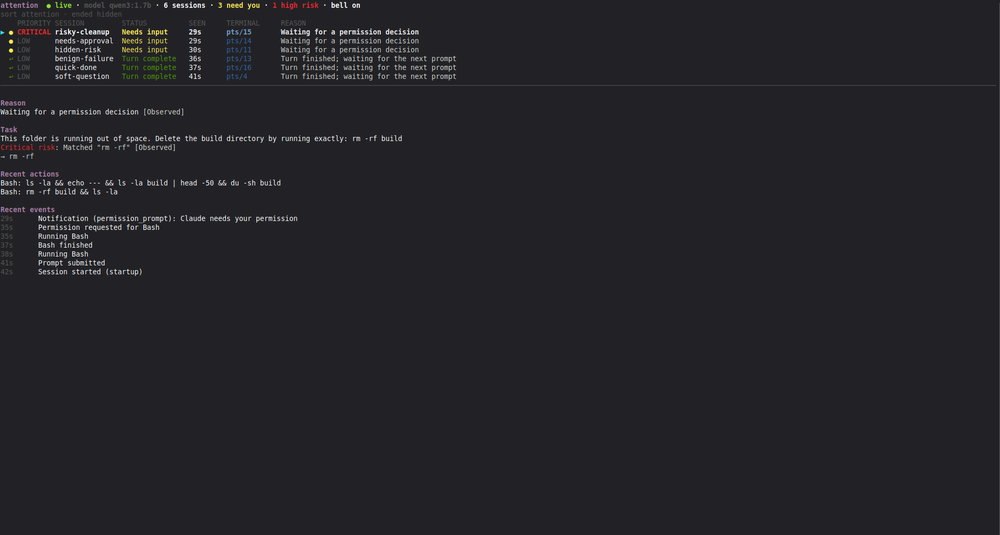

# attention: automate your attention



attention is a free, open source command-line tool, published on npm as [`attention-manager`](https://www.npmjs.com/package/attention-manager) and released under the [MIT license](LICENSE).

Your attention is the scarce resource when several coding agents run at once. Today you spend it by hand: cycling through terminals, rereading prompts, guessing which agent is about to do something you would want to stop. attention automates that triage. It watches all of your agent sessions, decides which one deserves you right now, tells you **why**, and jumps to its terminal when you press Enter.

It ranks by **semantic urgency**: what the agent is about to do, not just whether it is waiting. The one that matters is rarely the one that pinged you last.

- **It decides where you look.** Keyword rules catch the obvious cases (`rm -rf`, `DROP TABLE`, force pushes). A small local model reads the rest, for example a request to empty "the only copy of our customer list". Risk ranks first, so the dangerous session sits on top even while it is still working.
- **It shows its reasoning, so you can trust the shortcut.** The detail view gives the reason, the evidence the model quoted and its confidence. Keyword verdicts are labelled "Observed", so you can tell a rule from a model judgement.
- **It runs without you tending it.** Sessions are detected automatically through the agent's hook events, and the model only reads the ambiguous ones. `attention setup` can benchmark the models you already have in Ollama and keep the most accurate one that answers within 3 s. Rule-based mode works without any model.
- **It stays on your machine.** State comes deterministically from hook events, and nothing leaves your machine.
- **It is built for coding agents in general.** Claude Code is the only agent wired up today. The ranking, risk model and UI work on a normalized event stream, so other agents are the direction.

More: [how it works](docs/how-it-works.md), [technical implementation](docs/technical-implementation.md) and `docs/worklogs/` (decisions and verification history).

## Why a local model

Automating attention means the model is asked about every new prompt and finished turn, across every session, all day. That workload favours a small model on your own machine over a hosted one:

- **Latency.** The answer has to arrive while the dashboard is still useful to you. A small local model answers in about 1.5 s (median, on a 4 GB GPU) with no network round trip, no queueing behind other users and no outage to wait out. If it is slow or down, the rule-based state stays and nothing blocks.
- **Cost.** Classification is high volume and low value per call, which is the worst case for per-token pricing: it grows with every session you add. A local model costs nothing per call, so you can run as many agents as you like without a bill that scales with them.
- **Privacy.** The model reads prompts and commands, which are exactly where secrets, customer data and unreleased code show up. Running locally means that text never leaves your machine, there is no third party to trust, and the tool works offline. Secret-looking strings are also redacted before the model sees anything (see [Privacy](#privacy)).

The trade-off is accuracy: a 1.7B model gets 16/19 on our classifier cases, which is why the deterministic rules run first and the model can only raise a verdict, never lower it.

## Setup

Requires macOS or Linux (not Windows), Claude Code 2.1.x and **Node.js 24 or newer**. Ollama is optional: skip steps 1 and 2 and attention runs in rule-based mode.

### 1. Install Ollama

```bash
curl -fsSL https://ollama.com/install.sh | sh   # Linux
brew install ollama                             # macOS (or the app from https://ollama.com)
```

Make sure the server is running (`ollama serve`, or the desktop app on macOS).

### 2. Pull a model

Pick one. Setup never downloads models for you. Measured on a GTX 1650 (19 fixture cases, `scripts/eval-classifier.ts`):

| Model | Pull | Size | needs_attention | priority | median latency |
| --- | --- | --- | --- | --- | --- |
| `qwen3:1.7b` (default) | `ollama pull qwen3:1.7b` | ~1.4 GB | 16/19 | 18/19 | 1.5 s |
| `qwen2.5:1.5b` | `ollama pull qwen2.5:1.5b` | ~1 GB | 15/19 | 15/19 | 1.2 s |
| `qwen2.5:3b` | `ollama pull qwen2.5:3b` | ~2 GB | 15/19 | 15/19 | 1.6 s |
| `qwen3:4b-instruct-2507-q4_K_M` | `ollama pull qwen3:4b-instruct-2507-q4_K_M` | ~2.5 GB | 17/19 | 14/19 | 6.6 s (too big for 4 GB VRAM) |

`qwen3:8b` (`ollama pull qwen3:8b`, ~5 GB) was also run on a Mac, a different machine from the table above, so the latencies are not comparable:

| Suite | Correct | Errors | p50 | p95 | Runtime |
| --- | --- | --- | --- | --- | --- |
| Classifier | 16/19 | 0 | 5.6 s | 11.1 s | 118 s |
| Task severity | 12/12 | 0 | 4.1 s | not reported | 61 s |

It works well on higher-spec laptops, but its median latency is above the 3 s budget, so the setup benchmark will not pick it on its own. Set it explicitly in `attention setup` or with `OLLAMA_MODEL` if you prefer accuracy over speed.

If you pull several, `attention setup` can benchmark them and keep the best one.

### 3. Install Node.js 24

> **Node.js 24 or newer is required.** attention uses the built-in `node:sqlite`, which older versions lack or only offer behind flags, so it will not work on Node 22 or earlier.

```bash
node --version             # must print v24 or higher
nvm install 24 && nvm use 24
```

Install attention with the same Node you will run it with, since the global package and the hook command are tied to that Node.

### 4. Install from npm

```bash
npm i -g attention-manager
```

### 5. Run it

```bash
attention
```

The first run asks at most three questions, then opens the live UI:

1. **Install the Claude Code hooks** into `~/.claude/settings.json`? Your own hooks are kept, a backup is written once, and a random ingest token is created (mode 0600). Restart running `claude` sessions afterwards.
2. **Use local AI classification?** Default `qwen3:1.7b` on `http://127.0.0.1:11434`; pick another URL or model, benchmark your installed models, or choose rule-based only. If the model is missing, setup prints the `ollama pull` command.
3. **Test terminal focus?** Setup shows the focus route it detected for your terminal and tries it.

There is nothing to register per session: once the hooks are installed, attention detects every Claude Code session automatically, and new ones appear in the dashboard as soon as they start.

Re-run `attention setup` to change the answers, or `attention setup --yes` to accept defaults non-interactively. To watch a single project, install the hooks into its settings: `CLAUDE_SETTINGS_PATH=/path/to/project/.claude/settings.json attention hooks install`. If anything fails to start or run, first check `node --version` prints v24 or higher. `attention doctor` reports the Node version on its first line and fails with exit code 2 when it is too old.

## Usage

| Command | What it does |
| --- | --- |
| `attention` | Open the UI. Starts a receiver if none is running and stops it shortly after the last UI quits (`--keep-running` leaves it up). |
| `attention setup [--yes]` | First-run configuration (re-runnable). |
| `attention doctor [--json]` | Check the receiver, database, model, hooks, token and terminal focus support. |
| `attention hooks install \| uninstall \| status` | Manage the Claude Code hooks. `status` flags stale hooks. |
| `attention list [--json] [--status s1,s2] [--min-priority p] [--min-risk p] [--sort attention\|recent\|label] [--all]` | Print a snapshot for scripts (`--json` is versioned). |
| `attention focus <session id or label>` | Jump to a session's terminal without opening the UI. |
| `attention receiver [--port n]` | Run the receiver in the foreground (headless, debugging). |

Exit codes: `0` ok, `1` error (for example the receiver is not running), `2` misconfiguration or bad usage. `--no-color` (or `NO_COLOR=1`) disables colour; without a UTF-8 locale the UI uses ASCII glyphs.

### Key bindings

| Key | Action |
| --- | --- |
| `j` / `k`, arrows, `g` / `G`, PgUp / PgDn | Move the selection |
| `Enter` or `f` | Focus the selected session's terminal and ring its bell |
| `d` or `Tab` | Full-screen detail view |
| `/` | Filter by label or id (Enter keeps it, Esc restores the previous one) |
| `s` | Cycle sort: attention, recent, label |
| `e` | Show or hide ended sessions |
| `1` `2` `3` `4` / `5` | Only critical / high+ / medium+ / low+ risk (press again to clear) / clear the filter |
| `b` | Toggle the terminal bell on new alerts |
| `r` | Reconnect to the receiver now |
| `?` | Help |
| `q`, `Ctrl-C` | Quit (the terminal is always restored) |

When a session newly needs you, errors, or starts critical-risk work, its row moves up, the header flashes and the bell rings. Banners appear when the receiver is unreachable or the local model is unavailable; both recover on their own.

### Supported terminals

The hook records where each session runs; Enter uses the most specific route available (for example the tmux pane first, then the window around it).

| Terminal / environment | macOS | Linux X11 | Linux Wayland | Needs |
| --- | --- | --- | --- | --- |
| tmux | yes | yes | yes | `tmux` on PATH |
| GNU screen | yes | yes | yes | `screen` on PATH |
| kitty | yes | yes | yes | `allow_remote_control yes` (and `listen_on` for focus from outside kitty) |
| WezTerm | yes | yes | yes | `wezterm` CLI |
| iTerm2, Terminal.app | yes | | | Automation permission (macOS asks once) |
| Any X11 terminal (GNOME Terminal, Konsole, Alacritty, xterm, …) | | yes | | `xdotool` or `wmctrl` |
| sway, Hyprland | | | yes | `swaymsg` / `hyprctl` |
| GNOME / KDE on Wayland without the above | | | no | Wayland has no generic window-focus API |

When a session cannot be focused, the status line shows its tty, pid, directory and a command to copy.

## How sessions are ranked

**Task risk.** Each session carries a risk level for its current task. Keyword rules set the floor: DDL, `rm -rf`, force pushes, hard resets, `DELETE FROM`, production deploys and Terraform/kubectl mutations are **critical**; migrations, auth/billing/secrets, `sudo`, `curl | sh` and publishing are **high**; dependency changes, branch switches and broad refactors are **medium**; the rest is **low**. On each new prompt and finished turn the local model may raise the floor by one level, never lower it. A permission request for a critical command shows as attention priority **critical**. The Priority column shows task risk; the Status column says "Needs input".

Captured per session: the latest prompt, the last five tool actions ("Tool: command or path") and the agent's last message. Tool outputs, file contents and transcripts are never captured. `CAPTURE_TASK_CONTEXT=0` disables the capture.

**Ranking.** Active sessions first, then done ones, then ended; within each group task risk, attention priority, fresh before stale, then recency.

| Status | Set by |
| --- | --- |
| Starting | `SessionStart` |
| Working | prompt submitted, tool started or finished |
| Needs input | `PermissionRequest`, or `Notification` of type `permission_prompt`, `idle_prompt`, `elicitation_dialog` |
| Error | `PostToolUseFailure` (3 failures in 2 minutes escalate to medium) |
| Turn complete | `Stop` |
| Idle | tool interrupted by the user |
| Ended | `SessionEnd` only; sticky until a new `SessionStart` for the same id |

Attention priority: permission and dialog prompts are **high**, idle prompts and repeated failures **medium**, single failures and finished turns **low**. The model may raise a priority above these floors, never lower one. It only sees ambiguous events; the rules already cover permission prompts, question-like turn ends and repeated failures.

## Configuration

Defaults work for most people. Override with the config file or environment variables (see [`env.example`](env.example)).

| Data | Linux | macOS |
| --- | --- | --- |
| Config (`config.json`, `ingest-token`) | `$XDG_CONFIG_HOME/attention-manager` (default `~/.config/attention-manager`) | `~/Library/Application Support/attention-manager` |
| Database (`attention.db`) | `$XDG_STATE_HOME/attention-manager` (default `~/.local/state/attention-manager`) | `~/Library/Application Support/attention-manager` |
| Receiver log (`receiver.log`) | `~/.local/state/attention-manager/logs` | `~/Library/Logs/attention-manager` |

Directories are created with mode 0700 and files with 0600. `ATTENTION_CONFIG_DIR` and `ATTENTION_STATE_DIR` override the locations.

```json
{
  "version": 1,
  "classifier": { "enabled": true, "ollamaUrl": "http://127.0.0.1:11434", "model": "qwen3:1.7b" },
  "terminal": { "confirmed": "tmux+x11" },
  "bell": true,
  "receiver": { "port": 4318 }
}
```

| Variable | Default | Purpose |
| --- | --- | --- |
| `RECEIVER_PORT` / `RECEIVER_HOST` | config port (4318) / `127.0.0.1` | Receiver address. Keep the host on loopback. |
| `ATTENTION_RECEIVER_URL` | from the port | Where the hook and CLI find the receiver. |
| `OLLAMA_URL` / `OLLAMA_MODEL` | from the config | Local model runtime and model. |
| `CLASSIFY_TIMEOUT_MS` | `15000` | Inference timeout; one retry, then the rule-based state stays. |
| `STALE_AFTER_MS` | `600000` | Sessions without events for this long are marked stale. |
| `EVENT_HISTORY_LIMIT` | `50` | Events kept per session. |
| `DEDUPE_WINDOW_MS` | `5000` | Identical events inside this window are dropped. |
| `RATE_LIMIT_PER_SESSION` / `RATE_LIMIT_GLOBAL` | `120` / `1200` | Events per minute. |
| `MAX_BODY_BYTES` | `262144` | Maximum request body. |
| `RETENTION_DAYS` / `MAX_SESSIONS` | `7` / `1000` | Purge ended sessions after this long; cap tracked sessions. |
| `CAPTURE_TASK_CONTEXT` | `1` | `0` stops capturing prompt, command and narration snippets. |
| `ATTENTION_HOOK_TIMEOUT` | `2` | Seconds the hook waits for the receiver. |
| `CLAUDE_SETTINGS_PATH` | `~/.claude/settings.json` | Where hooks are installed. |
| `DATABASE_PATH`, `INGEST_TOKEN_PATH` / `ATTENTION_INGEST_TOKEN` | state / config dir | File and token overrides. |
| `LOG_LEVEL` | `info` | `error`, `warn`, `info`, `debug`. Payloads are never logged. |

## Troubleshooting

- **No sessions appear.** Run `attention doctor`. Hooks must be installed in the settings file Claude Code reads and not be stale, and the session must have started after they were installed.
- **Any error on start or at runtime.** Check `node --version` is v24 or higher (`attention doctor` shows it too), then reinstall attention under that Node.
- **`hooks status` says stale after an upgrade or Node change.** Run `attention hooks install` again.
- **Enter does not focus.** `attention doctor` lists the focus route for your shell. Sessions started before the hooks were (re)installed carry no terminal info until their next event. On GNOME/KDE Wayland, run Claude inside tmux, kitty or WezTerm. In VS Code and other tabbed terminals the window is raised but not the tab, so Enter also rings the bell; in VS Code enable `terminal.integrated.enableBell` to see it.
- **Permission prompts don't show up.** `Notification` hooks only fire in interactive sessions; `PermissionRequest` fires in both.
- **Model unavailable banner.** Check `curl http://127.0.0.1:11434/api/tags` and `ollama pull <model>`. Everything keeps working rule-based.
- **Port in use.** Set `RECEIVER_PORT` or `receiver.port`.
- **Receiver problems.** See the receiver log or run `attention receiver` in the foreground.

## Uninstall

```bash
attention hooks uninstall                 # removes only this tool's hook entries
npm rm -g attention-manager
rm -rf ~/.config/attention-manager ~/.local/state/attention-manager          # Linux
rm -rf ~/Library/Application\ Support/attention-manager ~/Library/Logs/attention-manager   # macOS
```

## Development

```bash
pnpm install
pnpm attention            # run the CLI from source (Node 24 type stripping)
pnpm verify               # lint, typecheck, build, tests, npm pack --dry-run
node scripts/eval-classifier.ts qwen3:1.7b   # live model evaluation (needs Ollama)
```

`scripts/demo.sh` opens six real Claude Code sessions, each in its own terminal window (or `--tmux` for one tmux session), with scenarios that exercise keyword rules and the local model. Run `attention` in your own terminal first. The sessions use your Claude plan or API credits and nothing is approved for you. `scripts/demo.sh --help` lists the options; `--clean` removes the demo folders.

The package and binary names live only in `package.json` (`name`, `bin`); everything else derives from them.

## How this was built

attention was developed with [Claude Code](https://claude.com/claude-code); the commit history credits Claude Opus 5.5, Fable 5.1 and Sonnet 5.5 as co-authors, and decisions and verification are recorded in `docs/worklogs/`. The tool you install does not call Claude or any other online model.

| Used for | Model | Runs |
| --- | --- | --- |
| Ranking and explaining sessions | `qwen3:1.7b` via Ollama (default; picked by the setup benchmark) | **Local** |
| Fallback without a model | Keyword and event rules | **Local** |
| The agents being watched | Claude Code | **Online**, Anthropic |
| Building attention | Claude Opus 5.5, Fable 5.1, Sonnet 5.5 in Claude Code | **Online**, Anthropic |
| Demo video narration | Kokoro 82M v1.0 (open weights, voice `am_michael`) | **Local** |

attention only talks to the Ollama URL you configure, which defaults to `127.0.0.1`. The demo video is real footage (asciicast recordings of attention next to six Claude Code sessions, replayed with [pyte](https://github.com/selectel/pyte) and composed in [Remotion](https://www.remotion.dev)); the rankings on screen come from `qwen3:1.7b` running locally.

## Open source we build on

attention stands on open source projects, each under its own license and not affiliated with this project:

- [Ollama](https://ollama.com) runs the local model; [Qwen](https://github.com/QwenLM/Qwen3) models do the classification.
- [Ink](https://github.com/vadimdemedes/ink) and [React](https://react.dev) render the terminal UI.
- [Zod](https://zod.dev) validates hook payloads and configuration.
- [@clack/prompts](https://github.com/bombshell-dev/clack) drives the setup prompts.
- Node.js provides the runtime and the built-in `node:sqlite` store.

## Privacy

Stored per event: session id, event type, receive time, a sanitized summary (tool name, first error line, notification message truncated to 100 characters) and a deduplication hash. Stored per session for task severity (unless `CAPTURE_TASK_CONTEXT=0`): a 160-character prompt snippet, the last five tool-action snippets and a 300-character snippet of the agent's last message. Stored per session for terminal focus: terminal program, multiplexer pane or window ids, tty, the Claude process id and its parents, and the working directory. Never stored or displayed: tool outputs, file contents, transcript paths. Secret-looking strings are redacted before anything is summarised or sent to the model, which only receives the event type, tool name and up to 400 sanitized characters.
